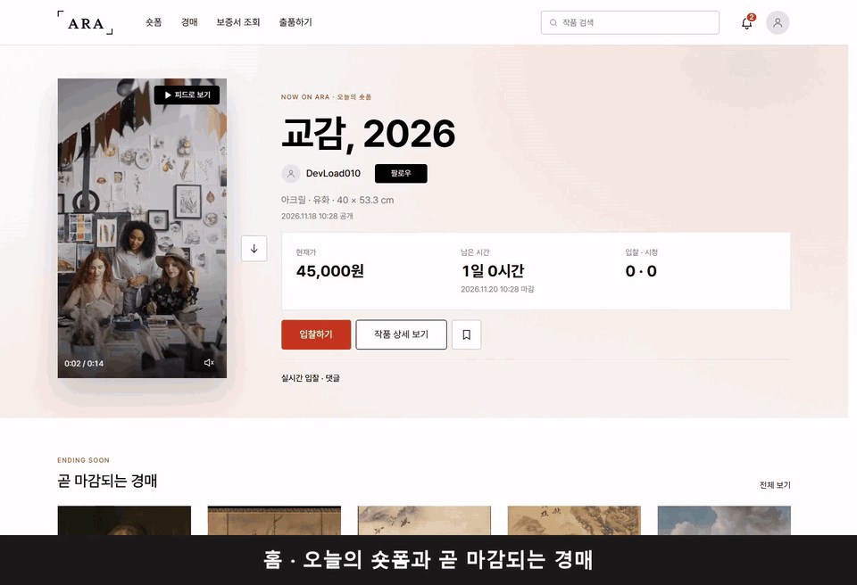
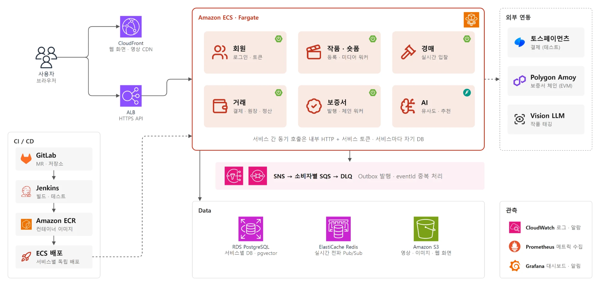
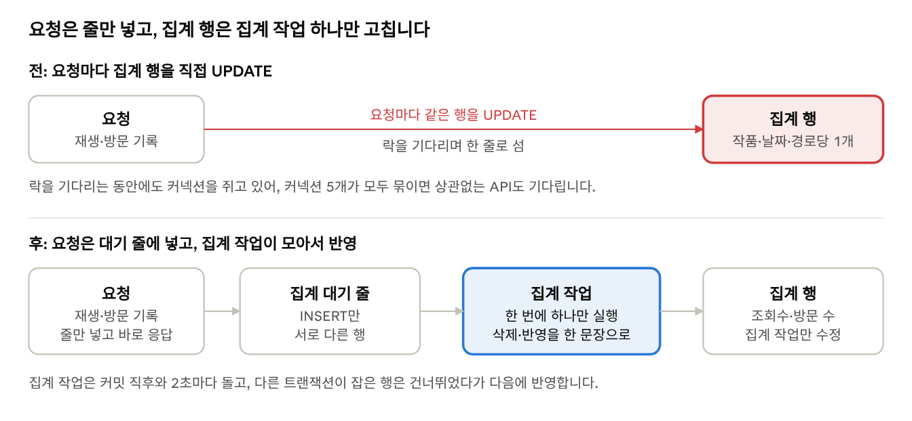
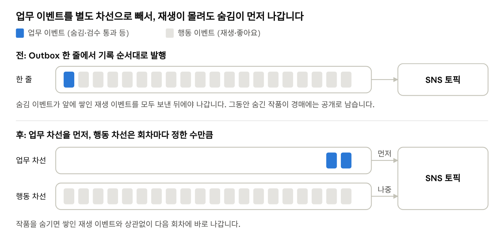
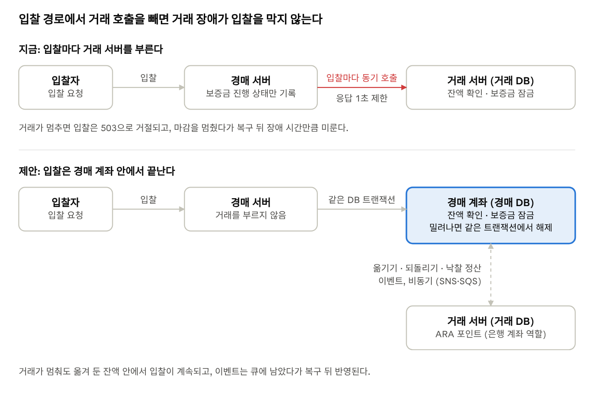

# 아티스트 릴스 옥션 (ARA)

> 작가의 작업 숏폼으로 작품을 알리고, 실시간 경매와 블록체인 보증서로 원화 거래까지 잇는 미술품 경매 서비스

  

  <a href="서비스개요.md">서비스 개요 (기능별 시연)</a> · <a href="docs/개선_상세.md">개선 상세 (측정 근거)</a>

## 프로젝트 개요

<table>
<thead>
<tr><th nowrap>항목</th><th nowrap>내용</th></tr>
</thead>
<tbody>
<tr><td nowrap>기간</td><td>2026.10.06 ~ 2026.11.18 (7주)</td></tr>
<tr><td nowrap>팀</td><td>6명, 도메인별 서비스 분리(MSA), ECS Fargate에 서비스별 배포</td></tr>
<tr><td nowrap>담당</td><td>작품·숏폼 도메인 백엔드, 영상 변환 워커, 서비스 전체 모니터링</td></tr>
<tr><td nowrap>기술</td><td>Java 21, Spring Boot 4, PostgreSQL 18, Flyway, Python, ffmpeg, AWS S3·SQS·SNS, Testcontainers, k6, Prometheus, Grafana</td></tr>
</tbody>
</table>

## 내가 한 일

- **작품·숏폼 백엔드를 설계부터 운영까지**: DB·API·이벤트 계약(Flyway V1~V29), 출품·검수·좋아요·댓글·알림함, 스트리밍용 HLS 영상으로 바꾸는 변환 워커
- **부하·장애 시험으로 병목 찾기**: k6로 과부하와 장애 6종을 재현해, 부하 중 다른 API 응답을 4.1초에서 45ms로 줄임
- **이벤트로만 연결되는 서비스 연동**: 업무 데이터와 같은 트랜잭션에 이벤트를 기록하는 Outbox와 AWS SNS·SQS로 다른 서비스와 연결, 중복·순서 역전 처리, 업무 이벤트 차선을 분리해 숨김 이벤트 지연을 362초에서 1.2초로 줄임
- **서비스 전체 모니터링**: 장애·정합성 대시보드, 업무 지표, 큐·DLQ 현황, 서비스 간 이벤트 흐름 지도(Grafana)
- **팀 개발 기반**: 코드 리뷰 템플릿, AI 도구 공통 작업 규칙과 다른 도메인 파일 수정을 막는 훅

## 전체 아키텍처

- **서비스 배포**: 회원·작품·경매·거래·보증서·AI 서비스 6개를 ECS Fargate에 따로 배포, 서비스마다 자기 DB 사용
- **서비스 간 연동**: 동기 호출은 내부 HTTP와 서비스 토큰, 비동기는 Outbox → SNS → 소비자별 SQS → DLQ
- **정적 자원·실시간**: 웹 화면과 영상은 S3와 CloudFront, 실시간 전파는 Redis Pub/Sub
- **내 담당**: 작품·숏폼 서비스와 미디어 워커, 관측 영역(CloudWatch·Prometheus·Grafana)의 대시보드와 알림

## 핵심 성과

<table>
<thead>
<tr><th nowrap>개선</th><th nowrap>지표</th><th nowrap>전</th><th nowrap>후</th></tr>
</thead>
<tbody>
<tr><td nowrap>조회수 집계 구조 변경</td><td>부하 중 다른 API 평균 응답</td><td nowrap>4.1초</td><td nowrap>45ms</td></tr>
<tr><td nowrap>재생 기록 묶어 쓰기</td><td>과부하 30초 동안 받아 낸 재생 기록</td><td nowrap>초당 120건 (약 3,600건)</td><td nowrap>초당 1,060건 (약 3.2만 건)</td></tr>
<tr><td nowrap>이벤트 발행 차선 분리</td><td>작품 숨김 이벤트 발행 지연</td><td nowrap>362초</td><td nowrap>1.2초</td></tr>
<tr><td nowrap>DB 장애 대응</td><td nowrap>장애 시 응답</td><td nowrap>30초 대기 후 500</td><td nowrap>2초 후 503</td></tr>
<tr><td nowrap>업로드 재시도 (프로젝트 후)</td><td>업로드 1회 실패 시 완료까지</td><td nowrap>28.1초</td><td nowrap>14.8초</td></tr>
</tbody>
</table>

같은 PC의 로컬 환경(DB 커넥션 5개)에서 같은 조건으로 전후를 쟀습니다.

## 문제 해결

### 1. 커넥션 풀 고갈의 진짜 원인은 행 락이었습니다

- **문제**: 조회수는 숏폼 재생 기록이 들어올 때마다 늘어나는데, 한 작품에 재생 기록이 몰리자 처리량이 초당 200건에서 멈추고, 관계없는 상세 조회까지 4.1초로 느려졌습니다.
- **원인**: 커넥션을 4배로 늘려도 그대로였고, DB 세션의 82%가 같은 조회수 행의 잠금(행 락)을 기다리고 있었습니다.
- **해결**: 요청은 대기 테이블에 한 줄만 넣고 집계 작업이 모아서 반영하게 바꿨습니다. `DELETE … RETURNING`으로 중복 반영을 막고, 작업끼리 서로 기다리는 교착은 잠긴 행을 건너뛰는 `SKIP LOCKED`로 막았습니다.
- **결과**: 다른 API 응답 4.1초 → 45ms, 처리량 초당 155건 → 약 560건, 조회수와 기록 수 정확히 일치

[자세히 보기](docs/개선_상세.md#1-커넥션-풀-고갈의-진짜-원인은-행-락이었습니다)

### 2. 내 부하가 다른 서비스를 늦추지 않게: 이벤트 발행 차선 분리

- **문제**: 재생이 몰린 직후 작품을 숨기면 숨김 이벤트가 362초 뒤에야 나가, 그동안 경매에는 공개 상태로 남았습니다.
- **원인**: 재생 이벤트와 업무 이벤트가 하나의 Outbox 대기열에 섞여 있었습니다.
- **해결**: 발행 속도를 올리면 AI 서비스 큐로 부담이 넘어가므로, 업무 이벤트를 먼저 보내는 차선을 따로 만들었습니다.
- **결과**: 숨김 이벤트 지연 362초 → 1.2초, 재생 이벤트 보관을 하루로 줄여 공용 DB 적재량 3.2GB → 0.5GB(계산값)

[자세히 보기](docs/개선_상세.md#3-내-부하가-다른-서비스를-늦추지-않게-이벤트-발행-차선-분리)

### 3. 처리 한도를 올리면서도 재생 기록은 잃지 않게

- **문제**: 과부하를 막으려고 동시 처리 상한을 두고 넘치는 요청을 429(요청이 너무 많음)로 거절하자, 실제 재생이 조회수와 추천 데이터에서 빠졌습니다.
- **판단**: 다섯 가지 방법을 비교했습니다. 한 줄씩 커밋하면 초당 3,500줄이 한계였지만, 200줄씩 묶으면 커넥션 하나로 초당 18만 줄을 썼습니다.
- **해결**: 서버에서 묶어 쓰기와 클라이언트 재전송을 함께 적용했고, 쓰기 스레드가 읽기 요청과 커넥션을 다투지 않게 했습니다.
- **결과**: 과부하에서 받아 낸 재생 기록 초당 120건 → 1,060건(30초 시험에서 약 3,600건 → 약 3.2만 건, 거절 22건), 22만 건 처리 후 조회수·기록 수·발행 이벤트 수 일치, 교착 0건

[자세히 보기](docs/개선_상세.md#2-처리-한도를-올리면서도-기록은-잃지-않게)

<b>그 밖의 문제 해결 (8건)</b>

- **장애가 길어져도 버티는 재시도**: SNS가 멈추면 스레드가 묶일 수 있는 시간을 최대 250초에서 회차당 약 15초로 줄임(계산한 상한)
- **장애를 직접 일으켜 보는 시험**: DB 장애 시 30초 대기 후 500 → 2초 후 503, 장애 중 로그 시간당 10MB → 1.7MB
- **업로드 한 번 실패로 변환을 처음부터 다시 하던 문제** (프로젝트 후): 실패한 파일만 다시 올려 완료 시간 28.1초 → 14.8초
- **방문 집계에 남아 있던 같은 락 문제** (프로젝트 후): 방문 처리량 초당 709건 → 1,391건(15초 측정에서 약 1.1만 건 → 약 2.1만 건)
- **메시지 중복과 순서 역전**: 처리한 eventId 기록, 락을 잡은 뒤 회차와 버전 재확인
- **조회수 부풀리기 방지**: HMAC 서명 쿠키, IP당 시간당 새 방문자 키 300개 제한
- **모니터링 쿼리 인덱스** (프로젝트 후): 102만 건 테이블 조회 30.2ms → 0.02ms
- **쓰지 않는 기능은 빼기**: 101.7ms 쿼리를 줄이는 대신, 보여 주는 화면이 없는 필드 자체를 없앰

[전체 기록 보기](docs/개선_상세.md)

## 기술 선택 이유

<table>
<thead>
<tr><th nowrap>선택</th><th nowrap>이유</th></tr>
</thead>
<tbody>
<tr><td nowrap>Outbox + SNS·SQS</td><td>업무 데이터와 이벤트 기록을 한 트랜잭션에 저장해 발행 누락을 막고, 다른 서비스가 느려도 작품 요청이 막히지 않게 하려고</td></tr>
<tr><td nowrap>브라우저에서 S3로 직접 업로드</td><td>큰 영상이 API 서버를 거치지 않게 하고, API는 파일 크기와 서명만 확인하려고</td></tr>
<tr><td nowrap><code>FOR UPDATE SKIP LOCKED</code></td><td>여러 인스턴스가 집계 대기 줄과 Outbox를 나눠 가져가도 서로 기다리지 않게 하려고</td></tr>
<tr><td nowrap>별도 영상 변환 워커</td><td>ffmpeg 변환을 API 서버와 분리해 Fargate 작업으로 실행하려고</td></tr>
<tr><td nowrap>Testcontainers</td><td>동시성과 락 동작은 실제 PostgreSQL에서 확인해야 해서</td></tr>
</tbody>
</table>

## 검토와 제안

**거래 서버가 멈춰도 입찰이 되도록, 경매 전용 계좌를 따로 두는 설계를 제안했습니다.** 지금은 입찰할 때마다 거래 서버에 보증금 잠금을 동기 호출해서, 거래 서버가 멈추면 입찰도 멈춥니다. 잔액 확인과 잠금을 한 트랜잭션에서 처리한다는 원칙은 지키면서, 그 트랜잭션을 경매 DB로 옮기는 방식입니다.

[제안 전체 보기](docs/개선_상세.md#개선-제안-거래-서버가-멈춰도-입찰이-되도록)
