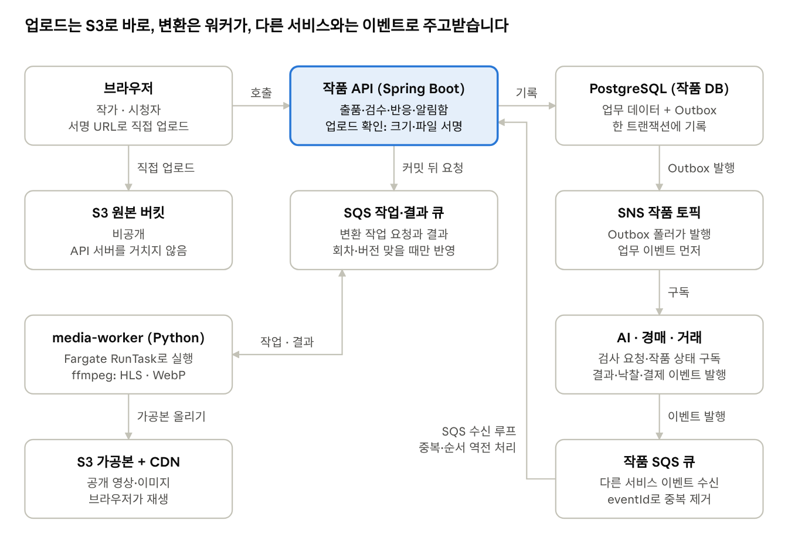
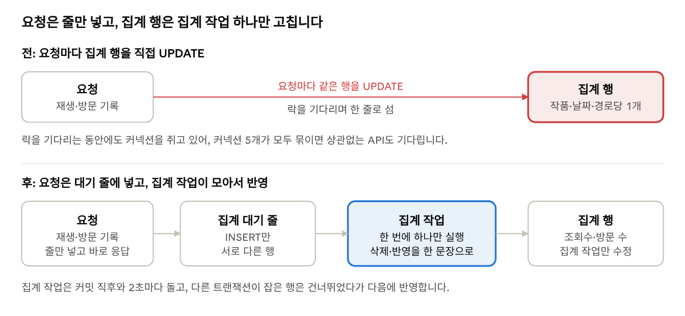
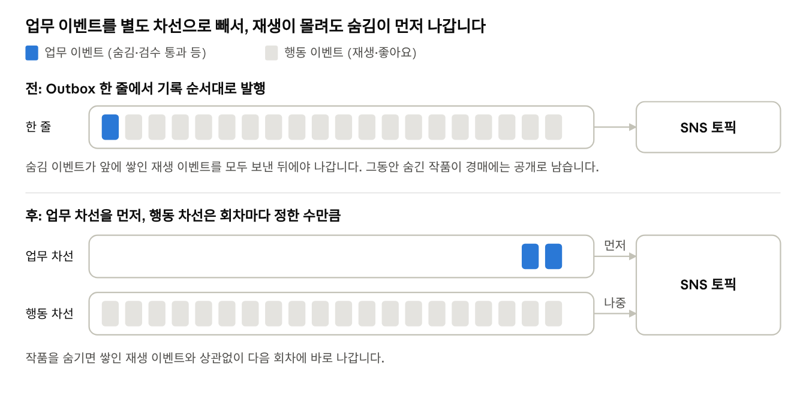
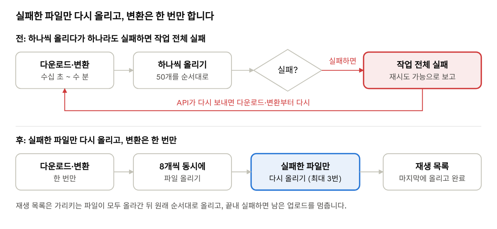
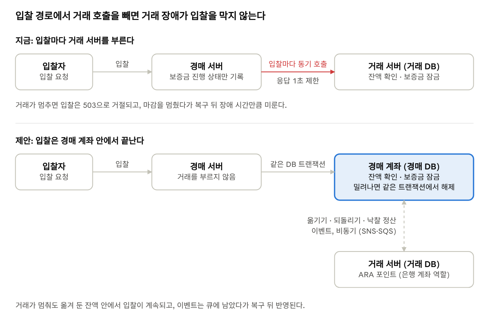

# 아티스트 릴스 옥션 (ARA) 개선 상세

[← README로 돌아가기](../README.md)

README에 요약한 문제 해결을 측정 조건과 판단 근거까지 담아 정리한 문서입니다.

## 작품 서비스 구조

영상과 이미지 파일은 API 서버를 거치지 않고 브라우저에서 S3로 바로 올라갑니다. API 서버는 올라온 파일의 크기와 파일 서명만 확인하고, 영상 변환은 별도 워커가 맡습니다. 다른 서비스를 직접 호출하지 않고 이벤트로만 주고받습니다. 업무 데이터를 저장할 때 같은 트랜잭션에서 이벤트도 Outbox 테이블에 기록해 두고, 이를 AWS의 메시지 서비스인 SNS(발행)와 SQS(수신 대기열)로 전달하는 방식입니다.

### 주요 구현

<table>
<thead>
<tr><th nowrap>영역</th><th nowrap>내용</th></tr>
</thead>
<tbody>
<tr><td nowrap>데이터·계약</td><td>Flyway 마이그레이션 V1~V29, 서비스 간 이벤트·API 계약 문서</td></tr>
<tr><td nowrap>출품·검수</td><td>임시 저장과 이어 쓰기, 운영자 검수와 공개, 재판매 검수</td></tr>
<tr><td nowrap>반응·탐색</td><td>실시간으로 갱신되는 좋아요와 댓글, 그림 태그 검색, 작가 페이지, 숏폼 저장</td></tr>
<tr><td nowrap>미디어 처리</td><td>HLS 변환(영상을 잘게 나눠 스트리밍하는 형식), 화질 상한과 HDR 변환, 9:16 자동 크롭, 변환 워커를 필요할 때만 Fargate 작업으로 띄우는 실행기</td></tr>
<tr><td nowrap>이벤트 연동</td><td>Outbox 발행, SQS 수신(중복과 순서 역전 처리), 서비스 간 토큰 인증</td></tr>
<tr><td nowrap>알림</td><td>알림함, 경매마다 상회 알림을 하나로 묶어 보내기</td></tr>
</tbody>
</table>

동시성과 경계 조건은 실제 PostgreSQL을 띄우는 Testcontainers 테스트로 확인했습니다.

## 성능·안정성 개선

느려졌다고 바로 서버를 늘리지 않고, 먼저 원인을 측정으로 확인했습니다. 고친 뒤에는 같은 조건에서 다시 재서 효과를 비교했습니다. 아래 수치는 모두 같은 PC의 로컬 환경(DB 커넥션 5개)에서 잰 값입니다.

<table>
<thead>
<tr><th nowrap>개선</th><th nowrap>지표</th><th nowrap>전</th><th nowrap>후</th></tr>
</thead>
<tbody>
<tr><td nowrap>조회수 집계 구조 변경</td><td>부하 중 다른 API 평균 응답</td><td nowrap>4.1초</td><td nowrap>45ms</td></tr>
<tr><td nowrap>같은 개선</td><td nowrap>헬스 체크 P95</td><td nowrap>7.1초</td><td nowrap>63ms</td></tr>
<tr><td nowrap>재생 기록 배치 쓰기</td><td>읽기와 섞인 과부하 30초 동안 받아 낸 재생 기록</td><td nowrap>초당 120건 (약 3,600건)</td><td nowrap>초당 1,060건 (약 3.2만 건)</td></tr>
<tr><td nowrap>이벤트 발행 차선 분리</td><td>작품 숨김 이벤트 발행 지연</td><td nowrap>362초</td><td nowrap>1.2초</td></tr>
<tr><td nowrap>DB 장애 대응</td><td nowrap>장애 시 응답</td><td nowrap>30초 대기 후 500</td><td nowrap>2초 후 503</td></tr>
<tr><td nowrap>방문 집계도 같은 구조로 (프로젝트 후)</td><td>한 작품에 15초 동안 몰린 방문 처리량</td><td nowrap>초당 709건 (약 1.1만 건)</td><td nowrap>초당 1,391건 (약 2.1만 건)</td></tr>
<tr><td nowrap>같은 개선</td><td>같은 커넥션 풀을 쓰는 다른 API P95</td><td nowrap>204ms</td><td nowrap>96ms</td></tr>
<tr><td nowrap>모니터링 쿼리 인덱스 (프로젝트 후)</td><td>102만 건 테이블 조회 시간</td><td nowrap>30.2ms</td><td nowrap>0.02ms</td></tr>
<tr><td nowrap>워커 업로드 재시도 (프로젝트 후)</td><td>업로드 1회 실패 시 완료까지</td><td nowrap>28.1초</td><td nowrap>14.8초</td></tr>
</tbody>
</table>

11/19로 표시한 항목은 프로젝트가 끝난 뒤 코드를 다시 점검하면서 찾아 고친 것입니다.

### 1. 커넥션 풀 고갈의 진짜 원인은 행 락이었습니다

작품 조회수는 숏폼 재생 기록이 들어올 때마다 늘어납니다. 한 작품에 재생 기록을 초당 600건씩 보내자 처리량이 초당 200건 근처에서 더 오르지 않았고, 관계없는 작품 상세 조회까지 4.1초로 느려졌습니다. 겉보기에는 커넥션 풀이 모자란 것 같았지만, 커넥션을 5개에서 20개로 늘려도 처리량은 그대로였습니다. DB 세션을 살펴보니 82%가 행 락(같은 행을 동시에 고치지 못하게 거는 잠금)을 기다리고 있었습니다. 재생 기록이 들어올 때마다 같은 작품의 집계 행을 UPDATE하고 있었던 것입니다.

그래서 요청은 집계 대기 테이블에 한 줄만 넣고, 별도 집계 작업이 모아서 반영하도록 바꿨습니다. 대기 줄을 지우는 일과 집계에 반영하는 일은 `DELETE … RETURNING` 한 문장으로 묶어, 같은 기록이 두 번 반영되지 않게 했습니다. 운영자가 작품을 한꺼번에 숨길 때 두 작업이 서로의 잠금을 기다리는 교착이 생기는 경우는, 두 세션으로 직접 재현한 뒤 다른 작업이 잠근 행은 건너뛰는 `SKIP LOCKED`로 막았습니다.

- 다른 API의 평균 응답 시간이 4.1초에서 45ms로 줄었고, 처리량은 초당 155건에서 약 560건으로 늘었습니다.
- 부하가 끝난 뒤 조회수와 재생 기록 수가 21,405건으로 정확히 같았습니다.
- 11/19 재점검에서 상세 방문 집계에도 같은 문제가 남아 있는 것을 찾아 같은 방식으로 고쳤습니다. 방문 처리량은 초당 709건에서 1,391건으로 늘었고(15초 측정에서 약 1.1만 건 → 약 2.1만 건), 락을 기다리던 세션 비율은 81%에서 0%가 됐습니다.

### 2. 처리 한도를 올리면서도 기록은 잃지 않게

과부하 때 서버를 보호하려고 재생 기록에 동시 처리 상한을 두고 넘치는 요청은 429(요청이 너무 많음)로 거절했더니, 이번에는 실제 재생이 조회수와 추천 데이터에서 빠졌습니다. 다섯 가지 방법을 비교했습니다. 한 줄씩 커밋하면 초당 3,500줄이 한계였지만, 200줄씩 묶으면 커넥션 하나로 초당 18만 줄까지 쓸 수 있었습니다. 이 측정을 근거로 **서버에서 묶어 쓰기**와 **클라이언트 재전송**을 함께 적용했습니다.

구현한 뒤 다시 재 보니 오히려 느려진 경우(초당 82건)가 있었습니다. 쓰기 스레드가 읽기 요청과 같은 줄에 서서 커넥션을 기다렸기 때문입니다. 쓰기 스레드가 커넥션 하나를 계속 잡고 이어서 쓰도록 바꿔 해결했습니다.

- 읽기와 섞인 과부하에서 받아 낸 재생 기록이 초당 120건에서 1,060건으로 늘었습니다. 30초 시험 기준으로 약 3,600건에서 약 3.2만 건이고, 거절된 보고는 22건이었습니다.
- 22만 건을 처리한 뒤에도 조회수, 기록 수, 발행 이벤트 수가 모두 같았고, 교착은 한 번도 없었습니다.

### 3. 내 부하가 다른 서비스를 늦추지 않게: 이벤트 발행 차선 분리

재생 이벤트와 작품 숨김 같은 업무 이벤트가 하나의 Outbox 대기열에 섞여 있었습니다. 재생이 몰린 직후에 작품을 숨기면 숨김 이벤트가 362초 뒤에야 나갔고, 그동안 숨긴 작품이 경매 쪽에는 공개 상태로 남아 있었습니다. 발행 속도만 올리면 AI 서비스 큐로 부담이 넘어갈 뿐이어서, 업무 이벤트를 먼저 보내는 차선을 따로 만들었습니다.

- 숨김 이벤트 발행 지연이 362초에서 1.2초로 줄었습니다.
- 재생 이벤트 보관 기간을 하루로 줄여, 공용 DB에 항상 쌓여 있던 양을 3.2GB에서 0.5GB로 줄였습니다(행 크기와 유입량으로 계산한 값).

### 4. 장애가 길어져도 버티는 재시도

SNS가 응답하지 않으면 스케줄러 스레드 하나가 최대 250초(50건 × 5초)까지 묶여, 다른 주기 작업까지 멈출 수 있었습니다. 연속으로 실패하면 그 회차를 바로 끝내도록 했고, 새 컬럼을 추가하지 않고 기존 재시도 횟수와 시각으로 각 이벤트를 언제까지 맡을지(선점 시간) 계산하게 바꿨습니다(`FOR UPDATE SKIP LOCKED`). 메시지 크기 초과처럼 다시 보내도 성공할 수 없는 실패는 보내기 전에 따로 걸러 냈습니다.

같은 메시징 구조를 쓰는 경매, 거래, 보증서 서비스의 수신 코드도 비교해 봤습니다. 그 과정에서 형식이 틀린 메시지를 삭제하던 제 규칙을, 삭제하지 않고 DLQ(처리에 실패한 메시지를 따로 모아 두는 대기열)에 증거로 남기는 팀 기준에 맞춰 고쳤습니다.

- 장애 중 스레드가 묶일 수 있는 시간의 상한이 250초에서 회차당 약 15초(3번 × 5초)로 줄었습니다. 둘 다 계산한 상한이고, 연속으로 실패하면 회차를 끊는 동작은 테스트로 확인했습니다.

### 5. 장애를 직접 일으켜 보는 시험

부하 테스트 도구 k6로 DB 중단, 인증 서버 연결 실패 등 장애 6가지를 직접 일으켜 봤습니다. DB가 멈추면 요청과 헬스 체크가 30초 동안 응답 없이 기다리다가 500을 돌려줬고, 이 상태로는 코드 버그와 구분할 수 없었습니다. 커넥션 대기 상한을 2초로 줄이고, 일시적인 장애에는 503(지금은 처리할 수 없음)으로 응답하게 했습니다. 미발행 이벤트 수와 응답 시간 분포 지표도 추가했습니다.

고친 뒤 다시 재 보니 로그가 여전히 많았습니다. Spring Boot의 DB 헬스 체크가 호출할 때마다 170줄짜리 스택 트레이스를 남기고 있었습니다. 이것까지 정리해 장애 중 로그를 시간당 약 10MB에서 1.7MB로 줄였습니다. 고친 항목은 시험의 필수 검사로 올려, 같은 문제가 다시 생기면 시험이 실패하게 했습니다.

### 6. 업로드 한 번 실패로 영상 변환을 처음부터 다시 하던 문제 (프로젝트 후)

60초짜리 영상 하나를 변환하면 S3에 올릴 파일이 50개 나옵니다. 기존 코드는 이 파일들을 하나씩 순서대로 올리다가 하나라도 실패하면 작업 전체를 실패로 처리했고, 작업을 다시 받으면 다운로드와 변환부터 새로 했습니다. 실패한 파일만 최대 3번까지 시도해 다시 올리고, 재생 목록 파일을 뺀 영상 조각은 8개씩 동시에 올리도록 바꿨습니다. S3 클라이언트 공통 설정은 바꾸지 않고, 작품 쪽 처리 코드 안에서 해결했습니다.

- 업로드 구간이 2.77초에서 0.59초로 줄었습니다.
- 업로드가 한 번 일시적으로 실패했을 때 완료까지 걸리는 시간이 28.1초(변환 2번)에서 14.8초(변환 1번)로 줄었습니다.
- 업로드 한 건에 50ms가 걸린다고 가정하고 합성 시험 영상으로 잰 값입니다. 실제 운영에서는 작업을 다시 받기까지 기다리는 시간이 더해지므로 차이가 더 커집니다.

### 그 밖의 사례

- **메시지 중복과 순서 역전**: 처리한 eventId를 기록하고, 락을 잡은 뒤 회차와 버전을 다시 확인했습니다. 재전송은 같은 회차로 보내, 같은 메시지가 두 번 이상 올 수 있는 SQS 메시지(at-least-once)를 데이터 손상 없이 처리했습니다.
- **조회수 부풀리기 방지**: 서명 없던 방문자 쿠키를 서버만 아는 키로 서명한 쿠키(HMAC)로 바꿔 위조를 막고, IP 하나가 한 시간에 만들 수 있는 새 방문자 키를 300개로 제한했습니다.
- **권한 확인 실패 구분**: 보증서 조회에서 받은 404를 응답 코드별로 구분해, 설정 실수가 "소유자 아님"으로 처리되지 않게 했습니다.
- **모니터링 쿼리 인덱스 (프로젝트 후)**: 1분마다 Outbox 테이블 전체를 읽던 지표 쿼리에 부분 인덱스를 추가했습니다. 102만 건에서 30.2ms 걸리던 조회가 0.02ms가 됐습니다.
- **쓰지 않는 기능은 빼기**: 101.7ms 걸리던 쿼리를 0.2ms로 줄일 방법을 찾았지만, 그 값을 보여 주는 화면이 없어서 필드 자체를 없앴습니다.

## 개선 제안: 거래 서버가 멈춰도 입찰이 되도록

지금은 입찰할 때마다 경매 서버가 거래 서버에 보증금 잠금을 동기 HTTP로 요청합니다. 그래서 거래 서버가 멈추면, 경매 서버가 살아 있어도 입찰을 받을 수 없습니다. 증권 계좌처럼 **경매 전용 포인트 계좌**를 따로 두고 경매 서비스가 직접 관리하면, 거래 서버가 멈춘 동안에도 미리 옮겨 둔 금액 안에서는 입찰을 계속 받을 수 있습니다.

### 지금 구조의 문제

- 포인트 잔액은 거래 DB에만 있고, 경매 쪽에는 보증금 처리 상태만 기록됩니다.
- 입찰할 때마다 거래 API를 호출합니다. 응답 제한은 1초이고 재시도나 서킷 브레이커는 없습니다. 잔액 확인과 잠금을 거래 DB의 한 트랜잭션에서 처리하려고 동기 호출을 택한 설계입니다.
- 거래 서버가 응답하지 않으면 입찰은 `503`으로 거절됩니다. 지금은 장애 동안 마감을 멈췄다가 장애 시간만큼 마감을 미루는 식으로 보정하고 있어서, 시간은 돌려주지만 장애 중에 입찰할 수 없는 것은 그대로입니다.

### 제안하는 구조

| 구분 | ARA 포인트 (거래 서비스) | 경매 계좌 (경매 서비스) |
| --- | --- | --- |
| 비유 | 은행 계좌 | 증권 계좌 예수금 |
| 입금 | 토스 충전, 환불, 경매 계좌에서 되돌린 돈 | ARA 포인트에서 옮긴 돈 |
| 사용처 | 낙찰 결제, 출금, 경매 계좌로 이체 | 입찰 보증금(입찰가의 30%) 잠금·해제 |

1. **이체**: 사용자가 ARA 포인트에서 경매 계좌로 금액을 옮깁니다. 거래 서비스가 잔액을 빼면서 같은 트랜잭션에 Outbox 이벤트를 남기고, 경매 서비스가 이를 받아 원장에 반영합니다. 같은 이벤트는 eventId로 한 번만 반영합니다.
2. **입찰**: 경매 DB의 한 트랜잭션 안에서 잔액 확인, 보증금 잠금, 입찰 기록을 처리합니다. 거래 서비스는 부르지 않습니다.
3. **상회와 취소**: 더 높은 입찰(상회)로 밀려난 입찰자의 보증금을 같은 트랜잭션에서 바로 풉니다. 지금 쓰는 환급 대기와 재시도 작업이 필요 없어집니다.
4. **낙찰**: 경매 계좌에서 보증금을 빼고 `AuctionWon` 이벤트에 금액을 담아 보냅니다. 거래 서버가 멈춰 있어도 이벤트는 큐에 남았다가 복구 후 처리되므로 마감을 멈출 필요가 없습니다.
5. **출금**: 남은 잔액은 이벤트로 ARA 포인트에 돌려줍니다.
6. **대사(두 장부 맞춰 보기)**: "이체 합계 − 돌려준 합계 − 낙찰 정산 합계"가 경매 계좌 잔액 합계와 같은지 주기적으로 비교하고, 어긋나면 정합성 대시보드에 표시합니다.

잔액 확인과 잠금을 한 트랜잭션에서 처리한다는 지금의 원칙은 그대로 두고, 그 트랜잭션이 일어나는 위치만 입찰 DB로 옮기는 것이 이 제안의 요점입니다.

### 다른 방법과 비교

<table>
<thead>
<tr><th nowrap>방법</th><th nowrap>거래 장애 중 입찰</th><th nowrap>변경 범위</th><th nowrap>한계</th></tr>
</thead>
<tbody>
<tr><td nowrap>현재: 장애 시간 보정</td><td nowrap>불가 (마감만 연장)</td><td nowrap>없음</td><td>장애가 길수록 경매 일정이 밀림</td></tr>
<tr><td nowrap>서킷 브레이커·거래 이중화</td><td nowrap>불가 (빨리 실패할 뿐)</td><td nowrap>설정·인프라</td><td>결합은 그대로, 장애 확률만 낮춤</td></tr>
<tr><td nowrap>경매별 참가 보증금</td><td nowrap>참가한 경매만 가능</td><td nowrap>경매·거래 계약</td><td>참가할 때는 거래가 필요하고, 경매마다 돈이 묶임</td></tr>
<tr><td nowrap>경매 전용 계좌 (제안)</td><td nowrap>옮겨 둔 잔액 안에서 가능</td><td nowrap>경매·거래 계약, 경매 원장, 대사</td><td>미리 옮겨야 하고, 돈이 두 DB에 나뉨</td></tr>
</tbody>
</table>

### 트레이드오프와 대응

- **사용 단계가 하나 늘어남**: 첫 입찰 때 필요한 만큼 이체하도록 안내하고, 입찰 화면에 경매 계좌 잔액을 보여 줍니다.
- **돈이 두 DB에 나뉨**: 이체, 되돌리기, 정산은 모두 같은 요청이 두 번 와도 한 번만 처리되게 하는 멱등키를 붙인 Outbox 이벤트로만 처리하고, 양쪽 장부를 정기적으로 맞춰 보며 어긋남을 찾습니다.
- **계약이 바뀜**: 보증금 API, `AuctionWon`, 미결제 몰수 처리가 바뀌므로 거래·경매 서비스와 계약부터 합의합니다.
- **장애 중에는 새로 이체할 수 없음**: 돈의 출처가 거래 서비스라 피할 수 없습니다. 장애 중에는 이미 옮겨 둔 금액까지만 입찰할 수 있습니다.

### 진행 순서와 검증

1. 계약 초안 작성: 이체·되돌리기 이벤트, `AuctionWon` 정산 필드, 경매 계좌 조회 API
2. 경매 원장 구현: 입찰 코드가 이미 `DepositClient` 인터페이스 뒤에서 보증금을 잡고 있어서, 원장 구현체를 하나 더 만들어 바꿔 끼우면 됩니다.
3. 대사 작업과 정합성 대시보드 패널 추가
4. 시연 런북의 "거래 서버 중지" 시나리오로 검증합니다. 장애 중 입찰 성공률(현재 0%)과 마감 연장 횟수(목표 0회)를 확인합니다.
