# ARA 서비스 개요

> 작가의 작업 숏폼으로 작품을 알리고, 실시간 경매와 블록체인 보증서로 원화 거래까지 잇는 미술품 경매 서비스

[← README로 돌아가기](README.md)

작가는 작업 과정을 숏폼 영상으로 올리고, 시청자는 피드에서 작품을 발견합니다. 마음에 드는 작품은 실시간 경매로 사고, 낙찰된 원화의 소유권은 Polygon 기반 디지털 보증서로 넘겨받습니다. 작품 등록부터 검수, 경매, 결제, 보증서 이전까지 한 서비스 안에서 이어집니다.

| 기능 | 설명 |
| --- | --- |
| 숏폼 피드 | 오늘의 숏폼, 개인 추천 피드, 좋아요·댓글 실시간 반영 |
| 실시간 경매 | 입찰이 다른 참여자 화면에 바로 반영되고, 마감 직전 입찰은 마감을 연장 |
| 작품 출품·검수 | 숏폼과 작품 정보를 올리면 AI 유사도 검사와 운영자 검수를 거쳐 공개 |
| 디지털 보증서 | 작품 정보와 소장 이력을 담은 NFT 보증서, 로그인 없이 진위 조회 |
| 결제 | 낙찰 작품을 ARA 포인트로 결제하고 대금은 거래 완료까지 보관 |
| 모니터링 | 서비스 6개의 이벤트 흐름, 장애·정합성 지표, 큐·DLQ 현황 |

## 1. 숏폼에서 경매까지

<table>
  <tr><th>웹</th><th>모바일</th></tr>
  <tr>
    <td>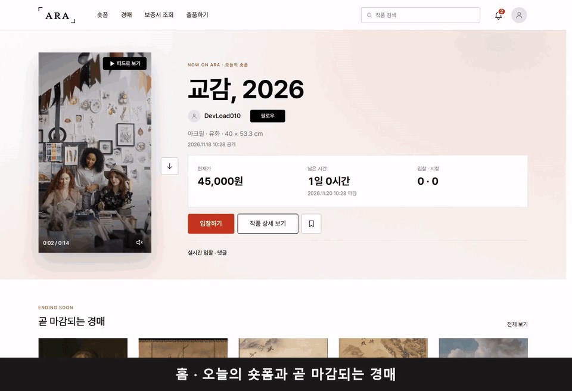</td>
    <td>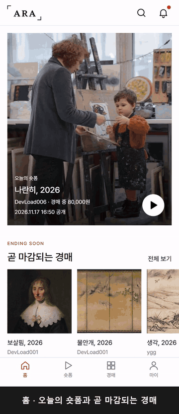</td>
  </tr>
</table>

홈의 오늘의 숏폼에서 피드로 들어가 작품 영상을 넘겨 보고, 좋아요와 댓글을 남깁니다. 좋아요와 댓글은 다른 사람 화면에도 바로 반영됩니다. 피드에서 경매 탭으로 넘어가면 해당 작품의 경매 상세가 열립니다.

**내 담당**: 숏폼 피드·좋아요·댓글 API, 재생 기록과 조회수 집계, HLS 영상 변환

## 2. 실시간 입찰과 낙찰

<table>
  <tr><th>웹</th><th>모바일</th></tr>
  <tr>
    <td>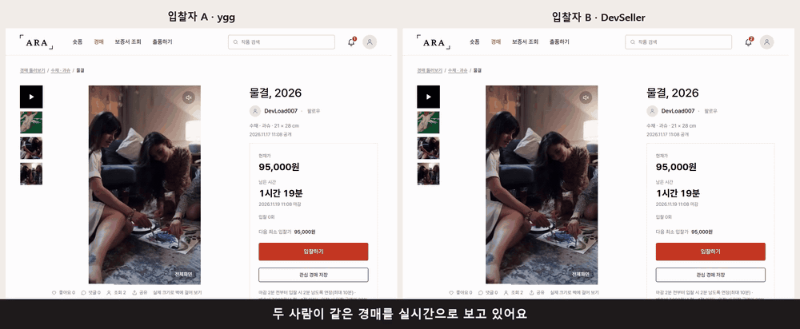</td>
    <td>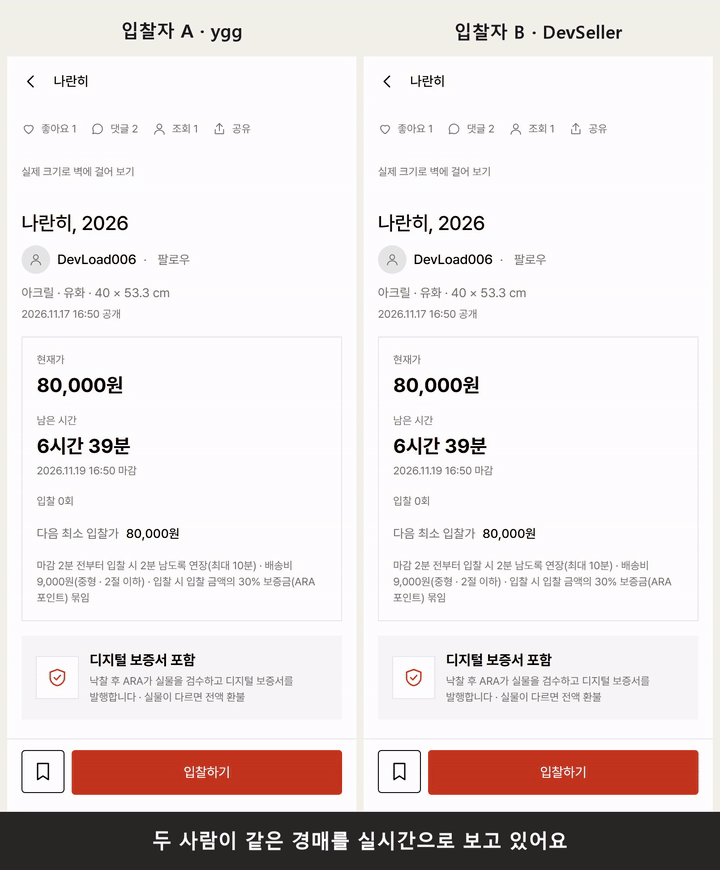</td>
  </tr>
</table>

두 입찰자의 화면을 나란히 놓았습니다. 한 사람이 입찰하면 다른 사람 화면의 현재가가 즉시 바뀌고, 상회 입찰과 재입찰이 오간 뒤 마감 10초 전 카운트다운을 거쳐 두 화면에 동시에 낙찰 결과가 뜹니다.

**내 담당**: 상회 알림을 경매마다 하나로 묶어 알림함에 전달

## 3. 작품 출품과 검수

<table>
  <tr><th>웹 · 출품과 검수 승인</th><th>모바일 · 같은 영상 재출품</th></tr>
  <tr>
    <td>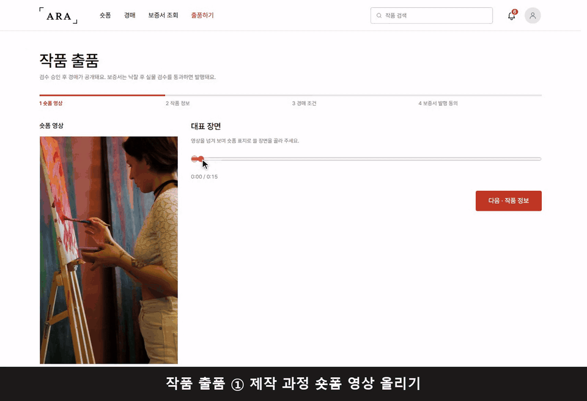</td>
    <td>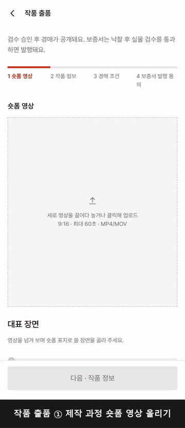</td>
  </tr>
</table>

작가는 숏폼 영상과 대표 장면, 작품 정보와 검수용 사진, 경매 조건, 보증서 발행 동의까지 4단계로 출품합니다. 운영자는 운영 콘솔에서 AI 유사도 근거와 사진, 숏폼을 확인한 뒤 승인하고, 작가 스튜디오에서 경매 시작을 확인할 수 있습니다. 같은 영상을 다시 올리면 AI 유사도 1.00으로 중복 경고가 뜨고, 운영자가 사유를 골라 반려하면 작가 스튜디오에 반려 사유가 표시됩니다.

**내 담당**: 출품·임시 저장·검수 API, S3 직접 업로드와 파일 서명 확인, AI 검사 요청과 결과 이벤트 처리

## 4. 디지털 보증서

<table>
  <tr><th>웹</th><th>모바일</th></tr>
  <tr>
    <td>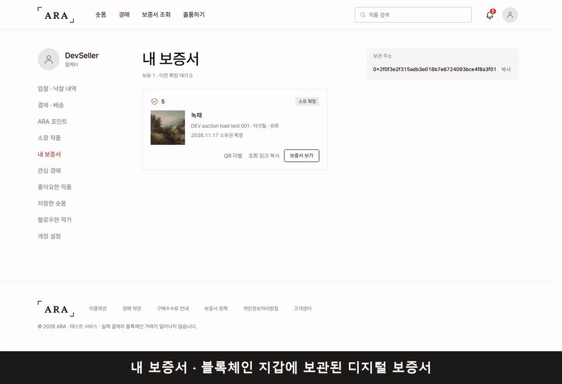</td>
    <td>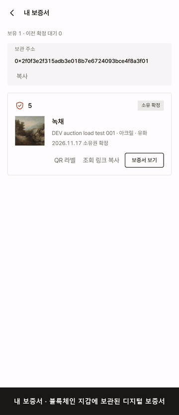</td>
  </tr>
</table>

내 보증서에서 보관 지갑 주소와 QR 라벨을 확인하고, 보증서 앞면에서는 작품 정보와 소장 이력을, 뒷면에서는 Polygon NFT의 컨트랙트와 토큰 ID, 발급·이전 기록을 봅니다. 보증서 번호만 있으면 로그인 없이 진위를 조회할 수 있습니다.

## 5. 낙찰 작품 결제

<table>
  <tr><th>웹</th><th>모바일</th></tr>
  <tr>
    <td>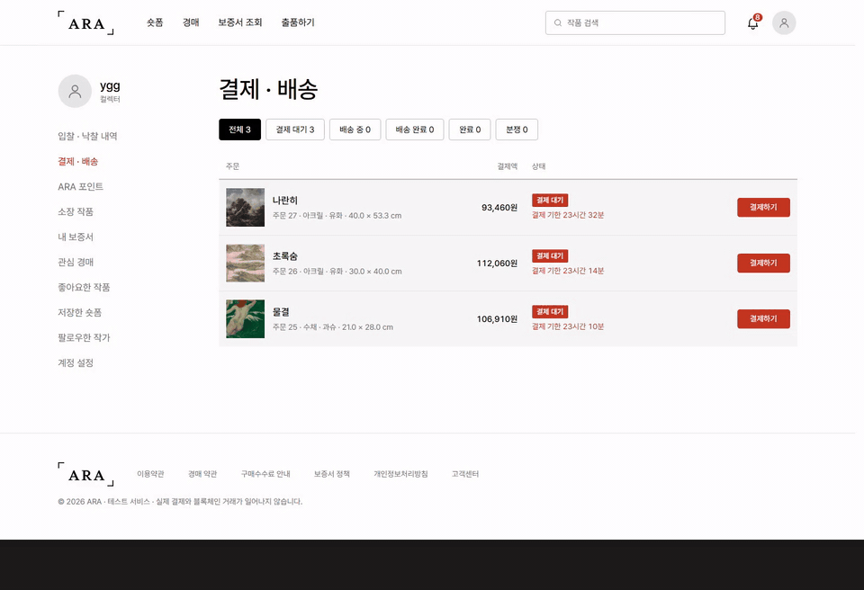</td>
    <td>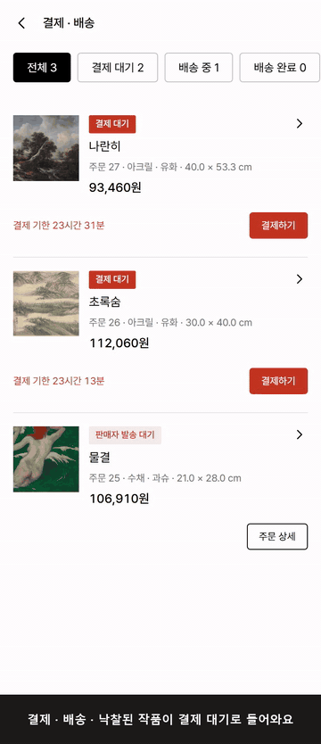</td>
  </tr>
</table>

결제 대기 주문에서 배송지를 입력하고, 보유한 ARA 포인트로 전액 결제합니다. 결제 대금은 거래가 끝날 때까지 서비스가 보관합니다.

## 6. 서비스 모니터링

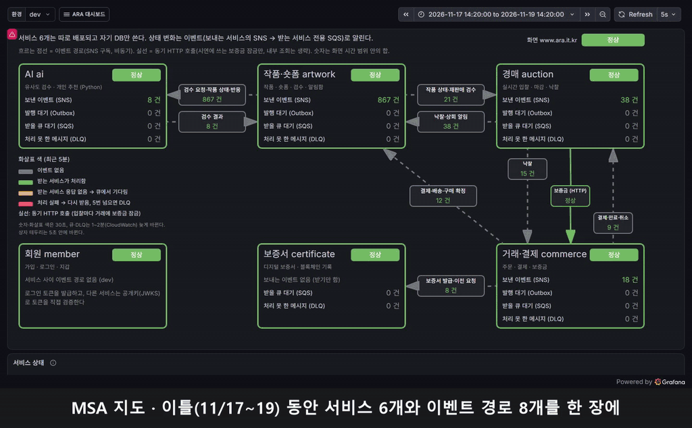

Grafana에서 서비스 6개와 이벤트 경로 8개를 지도로 보고, 낙찰·검수 이벤트 수, 장애·정합성 지표, 도메인별 상세, 큐와 DLQ 현황을 차례로 확인합니다. 모니터링 화면은 웹으로만 제공합니다.

**내 담당**: 서비스 전체 모니터링 대시보드, 업무 지표 수집, Grafana 알림, 서비스 간 이벤트 흐름 지도

시연 숏폼 영상은 Pexels에서 내려받은 무료 영상(<a href="https://www.pexels.com/license/">Pexels License</a>)이고, 작가 계정과 경매는 시연용 가상 데이터입니다.

---

[← README로 돌아가기](README.md) · [개선 상세 보기](docs/개선_상세.md)
